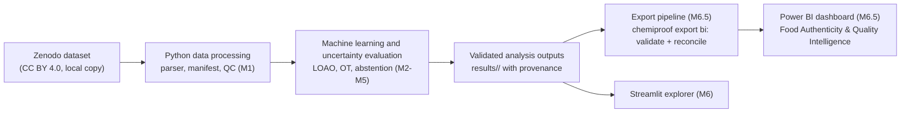

# Power BI Specification: Food Authenticity & Quality Intelligence (M6.5)

**Status: SPECIFICATION ONLY, milestone M6.5 NOT STARTED.** No Power BI file, export code or DAX exists in this repository, and nothing here has been validated in Power BI. Do not describe the dashboard as built, tested or validated until `docs/bi/20_POWER_BI_ACCEPTANCE_TESTS.md` has been executed with evidence.

Companion documents: `docs/bi/19_POWER_BI_DATA_MODEL.md` (tables, columns, relationships, KPIs), `docs/bi/20_POWER_BI_ACCEPTANCE_TESTS.md` (tests and Definition of Done), `config/bi/export_contract.yaml` (machine-readable contract).

## 1. Purpose and scope

Power BI is added as a **Business Intelligence and Quality Analytics layer** for food-science readers (laboratory analysts, QA/QC trainees, supervisors): it lets them explore dataset quality, model performance, uncertainty and research findings from **already validated experiment outputs**.

It does **not** replace Python, scikit-learn, the evaluation protocol, or the Streamlit research explorer (M6). It does not train models, tune thresholds, ingest raw spectra, or make fraud, safety or compliance decisions.

| Layer | Tool | Responsibility |
|---|---|---|
| Data, models, evaluation, uncertainty | Python (this repository) | the only place where metrics, intervals and abstention are computed |
| Interactive research explorer, single-file / batch screening | Streamlit (M6) | per-spectrum exploration and guarded screening |
| BI and quality analytics | Power BI (M6.5) | read-only analysis of exported results |
| Report and release | M7 | scientific report, model/data cards |

## 2. Architecture position



Data flows one way. Nothing flows back from Power BI to the models.

## 3. Non-negotiable rules for this layer

1. **No leakage.** Power BI reads finished evaluation outputs only. It never feeds model fitting, hyper-parameter or threshold selection, or the choice of a "best" model for a held-out set. Test labels appear only inside evaluation tables.
2. **Protocol identity.** Every number is tied to a `run_id`, `protocol_id`, `mode`, `model_key` and `scoring` (unclipped/clipped) and `scope_type` (fold/macro/pooled). Different protocols or modes are never combined (see `docs/bi/19_POWER_BI_DATA_MODEL.md`, rules P-1 to P-4).
3. **Transductive is labeled.** Optimal-transport results need a batch of unlabeled target spectra and always carry the warning: "TRANSDUCTIVE RESEARCH MODE: needs a batch of unlabeled target spectra; never advertise as single-file deployment performance."
4. **Published numbers are separate.** Values from Sun et al. (2026) live in `fact_published_reference`, are marked "published, not measured by ChemiProof", and are never plotted in the same series as measured values.
5. **Uncertainty is described by its method.** Prediction intervals are labeled with the actual method, nominal level, calibration protocol and the fact that observed coverage is empirical and not guaranteed under distribution shift. Abstention is a research-level review flag.
6. **No invented thresholds.** The dashboard defines no pass/fail limit, no regulatory threshold, no "authentic/adulterated" cut-off, and no traffic-light semantics.
7. **KPIs are reproducible.** Each KPI equals a Python recomputation from the same export (acceptance test BI021). No hard-coded numbers.
8. **Raw data are never modified or committed**; Power BI files that embed data (`.pbix`, cache files) are git-ignored.
9. **Unknown is shown as unknown.** Empty tables render explicit empty states ("0 rejected files", "no uncertainty experiment exported"), never placeholders.

## 4. Wording rules

| Use | Do not use |
|---|---|
| "estimated olive-oil volume fraction", "olive fraction (percent)" | "authenticity score", "purity", "% genuine" |
| "difference from the labeled fraction (percentage points)" | "accuracy %" for regression |
| "review required (research flag)" | "adulterated", "fraud detected", "fake", "safe", "unsafe", "compliant", "illegal" |
| "observed interval coverage on these held-out samples" | "guaranteed 90% coverage", "confidence that the oil is genuine" |
| "published value, not measured by ChemiProof" | presenting a published number next to ours as ours |
| "held-out adulterant system" | "test set" without saying that a whole adulterant is withheld |

Percentage-point language: errors in olive-oil fraction are reported in percentage points (pp), where 0.06 fraction = 6 pp. Labels are volume fractions in [0,1] (a/11 for the dataset ratios 1:10 to 10:1), shown as 9.09% to 90.91% on axes.

## 5. Export pipeline (specification)

Planned module `src/chemiproof/bi/` (not implemented) and CLI contract:

```bash
chemiproof export bi \
  --run results/M3_<run_id> --run results/M4_<run_id> ... \
  --manifest data/interim/sample_manifest.csv \
  --output exports/bi \
  [--format csv|parquet|both]        # default csv
```

Steps:

1. **Discover and check preconditions** for each run directory: `summary.json`, `config_resolved.yaml`, `git_state.json`, `dataset_manifest_sha256.txt`, `predictions.csv`, `metrics_by_fold.csv`; LOAO runs also `leakage_audit.json` with a passed canary. A missing item rejects that run with a clear status code; the export of other runs continues only if `--allow-partial` is given and the manifest lists what was skipped.
2. **Assign identity:** `protocol_id` from the versioned protocol map (`docs/bi/19_POWER_BI_DATA_MODEL.md`, rule P-2).
3. **Build tables** from the existing artifacts (no re-training, no re-scoring from raw spectra).
4. **Validate** with rules V-01 to V-12 (types, keys, units, reconciliation of metrics from predictions, provenance, leakage guard, no absolute paths).
5. **Write** deterministic CSV (and optional Parquet) plus `export_manifest.json` with file hashes.
6. **Refuse to overwrite** an existing export folder; refuse to write into `data/` or a source run folder.

Planned status codes (added to the taxonomy when implemented): `BI_CONTRACT_VIOLATION`, `BI_RECONCILIATION_FAILED`, `BI_RUN_REJECTED`, `BI_UNREGISTERED_PROTOCOL` (warning). Dependencies: CSV needs none; Parquet needs the optional extra `bi` (`pyarrow`), see ADR-016.

Interfaces required from earlier milestones (to be honored by M5, not yet existing): the uncertainty artifacts must state `interval_method`, `interval_nominal_level`, `calibration_protocol`, `calibration_n`, `ood_method`, `ood_threshold` and `threshold_fit_source`, and the selective-risk table must follow `docs/science/05_EVALUATION_PLAN.md` section 7. Until then the uncertainty tables are exported empty with `uncertainty_available=false`.

## 6. Dashboard: "ChemiProof: Food Authenticity & Quality Intelligence"

### 6.1 Shared elements on every page

- **Header strip:** report title; selected `run_id` (short), `protocol_id`, `run_class` (locked/exploratory), `mode`, `subset_brand`, `git_head` (short), `config_sha256` (short), contract version.
- **Slicers:** Run (single select, default = the latest headline run), Model, Scoring (default `unclipped`), held-out adulterant / fold, brand. KPI cards use the run guard measure (`m_RunGuardOK`); with an ambiguous selection they show a "select one run" message instead of a number.
- **Footer:** "Research prototype, not a certified authenticity test or a regulatory finding. Data: Sun et al. (2026), Zenodo 10.5281/zenodo.19755088 (CC BY 4.0). Results are experimental and limited to one instrument, five adulterant systems and laboratory mixtures."
- **Style:** colour-blind-safe categorical palette; no red/green pass-fail meaning; text alternatives for every visual; consistent units in titles ("MAE, percentage points").
- **Hidden tooltip page:** provenance tooltip (run, protocol, mode, hashes) attached to metric visuals.

### 6.2 Page 1: Dataset & Quality Overview

Data: `dim_sample`, `dim_adulterant`, `dim_brand`, `fact_data_quality`, `fact_data_issues`. Needs M1 only.

| Visual | Content | KPI |
|---|---|---|
| Cards | total samples (with "published expectation 330" caption), adulterant systems, brands, rejected files, QC-warning samples, mean spectral completeness | K01, K05, K06, K07 |
| Bar (observed vs expected) | samples by adulterant next to the published expectation | K02 |
| Stacked bar / matrix | adulterant x brand x measurement round counts (shows the imbalance) | K03 |
| Column | olive-oil concentration distribution (percent, ten levels) by round | K04 |
| Table | QC flags and counts; negative-intensity samples; duplicate-content samples | K07, K08 |
| Table | data issues list; empty state "0 rejected files" | K06 |

Notes: files that fail validation are rejected by the parser, so invalid samples appear in the issue list, not in `dim_sample`; the page must say so. "Quality indicators" are descriptive (completeness, QC flags, inventory gap against the published design), not pass/fail verdicts.

### 6.3 Page 2: Machine Learning Performance

Data: `fact_predictions`, `fact_model_metrics`, `dim_experiment`, `dim_model`, `dim_fold`. Needs M3 (and M4 for OT runs).

| Visual | Content | KPI |
|---|---|---|
| Cards | MAE (pp), RMSE, bias, R2, each captioned with scope (pooled or macro) and scoring | K09 to K12 |
| Scatter | actual vs predicted olive fraction, colour = held-out adulterant, y = x reference line | K09 |
| Histogram and scatter | residual distribution; residual vs true concentration | K11 |
| Clustered bar | metrics by held-out adulterant (the five LOAO folds), n shown | K09 to K12 |
| Table | LOAO table: fold, n, MAE (pp), RMSE, bias, R2, out-of-range count | K13, K14 |
| Table | "by experiment": one row per run with `protocol_id`, `mode`, `run_class`, `subset_brand`, metric values; no mixed single chart | K09 |
| Callout | worst fold and R2 spread across the five folds | K13 |

Mode and protocol are always visible; transductive rows carry the transductive warning; the inductive control `svr_no_adaptation` is shown as an inductive row.

### 6.4 Page 3: Uncertainty & Screening Assessment

Data: `fact_uncertainty`, `fact_selective_risk`, `fact_predictions`. **Needs M5.** If `uncertainty_available=false`, the page shows only the banner "No uncertainty or abstention experiment has been exported (M5 not delivered)" and no values.

| Visual | Content | KPI |
|---|---|---|
| Cards | observed interval coverage (labeled empirical, with method and nominal level), mean interval width, abstention rate, retention | K15 to K17 |
| Interval plot | per held-out sample: interval, true value, covered or not | K15 |
| Line | error vs coverage: selective MAE (pp) against retention, with the random-abstain control and markers at 100/90/80/70% | K18 |
| Clustered bar | MAE with and without abstention, always beside the retention | K18 |
| Table | "Samples flagged for additional review (research cue)": sample, adulterant, brand, reason code | K19 |
| Method card | `interval_method`, nominal level, calibration protocol and size, `threshold_fit_source`, exchangeability caveat | n/a |

Rules: a flagged sample is never described as adulterated; a high abstention rate must not be shown as an improvement without its retention; coverage is per held-out adulterant and described as observed.

### 6.5 Page 4: Scientific Research Insights

Data: `fact_model_metrics`, `fact_robustness`, `fact_ot_diagnostics`, `fact_published_reference`, `fact_uncertainty` (OOD part), `dim_experiment` (limitations).

| Visual | Content | KPI |
|---|---|---|
| Model comparison | baselines inside ONE protocol (e.g. `LOAO-v1`): macro MAE and fold range per model, with the mean-predictor floor | K09, K13 |
| Separate panel | transductive models (e.g. `LOAO-OT-v1`) with the warning banner and the no-adaptation control | K09, K20 |
| Conditions | same protocol, different sample sets (all samples vs one brand) side by side | K09 |
| Brand view | descriptive error by brand inside each held-out fold | K03, K09 |
| Robustness | stress batches (size, brand, label skew) vs the no-adaptation control; negative control (permuted source labels) | K21 |
| OT diagnostics | iterations, convergence flag, marginal error, total mass per fold | K20 |
| OOD (only if M5 provides it) | OOD-score distribution per held-out adulterant, no detection-rate claim | n/a |
| Published reference panel | published values labeled "published, not measured by ChemiProof" with the authors' caveats | n/a |
| Findings and limitations | text fed from `dim_experiment.limitations_text` and the milestone reports; no hand-typed numbers | n/a |

## 7. Environment and practical limitations (checked against Microsoft Learn on 2026-11-03)

- **Power BI Desktop runs on Windows only** (Windows 10 or later client; Windows on ARM needs a specific cumulative update; Windows Server is not recommended). There is **no macOS version**. The repository owner works on macOS, so M6.5 needs one of: a Windows PC; Windows in a virtual machine (verify ARM/x64 compatibility on Apple silicon before relying on it); a cloud Windows desktop such as Windows 365 or Azure Virtual Desktop (documented by Microsoft as supported for Power BI Desktop); or a shared Windows machine.
- **Power BI Desktop does not require signing in.** The Power BI service (web authoring, sharing, scheduled refresh) requires a work or school account; personal e-mail addresses such as Gmail are not accepted directly (Microsoft documents a Microsoft 365 trial route for people without such an account; eligibility must be verified). The first deliverable should therefore use Desktop only, with no cloud publishing.
- **Project format:** prefer Power BI Projects (`.pbip`: plain-text TMDL for the model and PBIR for the report; git-friendly) over `.pbix` (binary, cannot be diffed or validated outside Desktop). Text files can be edited in VS Code on macOS, but they can only be **loaded and verified in Power BI Desktop**; generated TMDL/PBIR is therefore UNVALIDATED until opened there.
- **In the macOS development environment of this repository** a native `.pbip`/`.pbix` cannot be built or validated. This limitation must be recorded in the M6.5 review; the dashboard must not be reported as built without Windows verification. If no Windows environment is available, M6.5 is recorded as BLOCKED, and the Streamlit explorer (M6) remains the visual layer.
- **Publishing:** the repository forbids "publish to web" or any public publishing before the M7 rights review. Publishing data derived from the CC BY 4.0 dataset requires attribution; the report footer provides it.

## 8. Source control layout (planned)

```text
bi/powerbi/                         # planned; created in M6.5 on Windows
  ChemiProofBI.pbip
  ChemiProofBI.SemanticModel/       # TMDL (tables, relationships, measures)
  ChemiProofBI.Report/              # PBIR (pages, visuals)
  README.md                         # open/refresh procedure, ExportFolder parameter
```

`.gitignore` excludes `*.pbix`, `.pbi/localSettings.json`, `.pbi/cache.abf` and `exports/bi/`. Exports and screenshots made from real data may be committed only after the owner confirms rights and size (see `docs/science/10_REFERENCES_AND_LICENSES.md`).

## 9. Dependencies on existing milestones

M6.5 sits between M6 and M7 and does not renumber them. Formal prerequisites: **M5** (uncertainty and abstention outputs and their method metadata) and **M6** (shared artifact conventions). Per task: data-quality work needs M1; performance work needs M3 and M4; uncertainty work needs M5; the whole milestone is closed only after the owner has verified the report on Windows. M7 does not depend on M6.5 (ADR-016): if M6.5 is not accepted, the release README states "Power BI layer: not delivered".

Task cards CP-651 to CP-660 are defined in `docs/project/06_MILESTONES.md` (section M6.5) and listed in `docs/project/16_TASK_BACKLOG.md`.

## 10. Known limitations and unresolved items

1. Nothing in M6.5 exists yet; all measures and schemas are drafts.
2. Uncertainty and abstention data do not exist until M5; Page 3 is specified against interfaces, not results.
3. Verification requires Windows and Power BI Desktop, which are not available in the current macOS environment.
4. The protocol map is seeded from five existing runs; new protocols need an ADR.
5. Parquet support adds an optional dependency whose benefit over CSV is typed columns only; CSV alone is sufficient for the first version.
