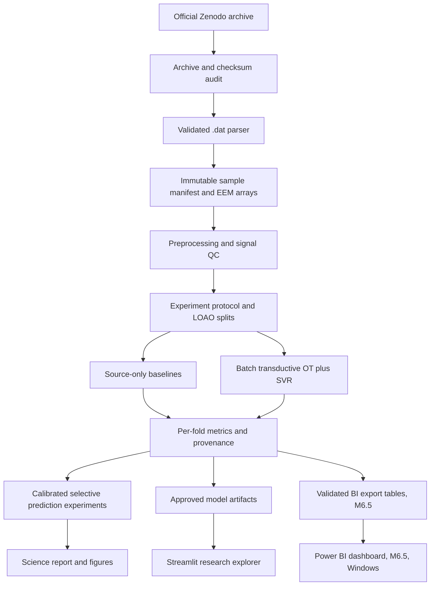

# Software Architecture & Data Flow

## Design principles

- **Research-first, local-first, reproducible.** Do not build a cloud platform while scientific model work is unverified.
- Clean boundaries between ingest, numerical processing, training/evaluation, and presentation.
- **No deployed model by default**; a user-facing predictor is enabled only when a vetted model artifact exists.
- Honor scientific mode: **single-sample inductive** vs **unlabeled-batch transductive**.
- Small verified dependencies and deterministic experiment results; no unnecessary generative AI layer.

## High-level pipeline



## Proposed package layout (directories to implement during M0–M6)

```text
ChemiProof/
├── README.md, docs/vi/START_HERE_VI.md, CLAUDE.md, AGENTS.md
├── docs/                      # specifications and decisions
├── config/
│   ├── project.yaml
│   ├── experiments/
│   │   ├── baseline.yaml
│   │   └── ot_transductive.yaml
│   └── schema.yaml            # config validation, if needed
├── src/chemiproof/
│   ├── cli.py                 # Typer/argparse commands after M0
│   ├── data/{download,unpack,parser,schema,audit}.py
│   ├── spectra/{preprocess,qc,visualize}.py
│   ├── modeling/{baselines,ot,artifacts}.py
│   ├── evaluation/{splits,metrics,runner,calibration,robustness}.py
│   ├── reports/{tables,render,provenance}.py
│   ├── bi/{contract,export,kpis}.py   # M6.5: validated export to Power BI tables (planned)
│   └── ui/app.py              # Streamlit after M6
├── tests/{unit,integration,science}_*.py
├── data/{raw,interim,processed,fixtures}/
├── results/<experiment_id>/
└── .github/workflows/ci.yml
```

Directory names above are **planned**, not assertions of implemented modules.

## Interfaces / contracts

### `load_dataset(manifest_path) -> Dataset`

Returns aligned records with sample IDs and source hashes. Fails if label provenance inconsistent or raw files missing. Should avoid loading full archive repeatedly.

### `preprocess(spectrum, config, fitted_state=None) -> Spectrum`

Fixed spectral operations and fit-dependent transforms separately. Return history/parameter digest, QC warnings and feature vector (9,450 after valid preprocessing). Do not mutate source arrays in-place.

### `make_outer_folds(manifest) -> FoldList` (implemented as `evaluation.protocols.loao_folds`)

Exactly five outer folds, each with disjoint source/test adulterant types and sample IDs. All samples from one adulterant are target. Save immutable split manifest. Source-internal validation partitions avoid replicate leakage.

### `fit_baseline(source_train, source_val, cfg) -> ModelArtifact` (implemented as `modeling.baselines.model_factory` + `evaluation.runner`)

Fit preprocessing and model solely on permitted source. Bundle feature-schema version, label unit, data provenance and fitted transformations.

### `fit_transductive(source, target_X_unlabeled, cfg) -> BatchModelArtifact`

Uses **target features only**, no target y. Constructs OT mapping and predicts a specified batch; log batch size and hashes, transport solver settings and numerical convergence. Must never be called as if it were a stable independent single-file artifact.

### `evaluate(method, fold, cfg) -> MetricsReport`

Accepts external ground truth only for final scoring. Produces per-fold predictions + verified metric units + report; no tuning after scoring.

### `screen_single(file, inductive_artifact) -> ScreeningResult`

QC → compatible trained source-only model → estimated olive fraction or **ABSTAIN/UNSUPPORTED**. No batch OT implicitly.

### `screen_batch(files, ot_research_protocol) -> BatchResearchResult`

Deliberate, clearly labeled batch transductive mode; no promise of deployment independence.

## Artifact schema and reproducibility

Each completed run folder:

```text
results/<run_id>/
  config_resolved.yaml
  environment.json
  git_state.json
  dataset_manifest_sha256.txt
  splits.csv
  predictions.csv
  metrics_by_fold.csv
  summary.json
  figures/
  validation_report.md
```

`run_id = UTC timestamp + short git hash + short config hash`, no hidden mutation. Require `model_id`, `preprocess_version`, `train_sample_ids_hash`, `mode`, `seed`, `data_source_doi`, `software_versions`, and `limitations`. Serialization prefer safe framework-native formats and restricted loading from trusted generated paths. Avoid `pickle` from untrusted sources.

## Error and status taxonomy

- `BAD_FILE_FORMAT`
- `INVALID_WAVELENGTH_GRID`
- `NONFINITE_SPECTRUM`
- `UNVERIFIED_LABEL`
- `NO_TRAINED_MODEL`
- `TRANSDUCTIVE_BATCH_REQUIRED`
- `QC_REVIEW_REQUIRED`
- `ABSTAIN_OOD_RISK`
- `INSUFFICIENT_CALIBRATION`
- `NUMERICAL_NONCONVERGENCE`
- `LICENSE_REVIEW_PENDING`
- *(planned with M6.5)* `BI_CONTRACT_VIOLATION`, `BI_RECONCILIATION_FAILED`, `BI_RUN_REJECTED`, `BI_UNREGISTERED_PROTOCOL`

All statuses have a human-readable description and recorded technical context. UI must not pretend all are “negative for adulteration”.

## BI export layer (M6.5, specification only)

`export_bi(run_dirs, manifest, out_dir) -> ExportManifest` reads finished run directories (no retraining, no raw spectra) and writes the contract tables of `docs/bi/19_POWER_BI_DATA_MODEL.md` (CSV, optional Parquet) with an `export_manifest.json` carrying run, protocol, config/manifest hashes, git state and file hashes. It validates keys, units and provenance, reconciles metrics from predictions, rejects LOAO runs without a passed leakage canary, never writes inside `data/` or a source run folder, and exports empty uncertainty tables (flagged) when M5 outputs do not exist. Power BI consumes the folder read-only; nothing flows back to the models. Machine-readable contract: `config/bi/export_contract.yaml`.

## Versioning and test architecture

- Version schemas (`spectrum_schema`, `config_schema`, `model_schema`). Reject incompatible artifacts.
- GitHub Actions initially lint/test using **synthetic fixtures only** and no 96 MB fetch.
- Dataset-requiring science benchmark is an explicit local job or permitted CI external data workflow (do not auto-download without policy review).
- Prefer deterministic functions and pure data transformations; dependencies injected as arguments.
- UI reads validated result artifacts rather than recomputing expensive experiments on every refresh.

## Infrastructure choice

**M0–M5:** Python project with CLI and local filesystem, no DB/server.  
**M6:** Streamlit local interactive research explorer.  
**M6.5 (optional extension):** Power BI Desktop (Windows) as a read-only presentation layer fed by the validated export; no server, gateway or cloud publishing assumed.  
**Future:** external DB/API/cloud only when multiple users, collaboration or authenticated deployment are a proven requirement.
