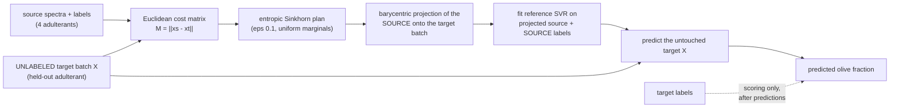

# M4 Published-style optimal-transport replication: validation report

**Date:** 2026-11-02 · **Protocol:** `LOAO-OT-v1`, frozen by ADR-014 before any scored OT run (stress test declared in ADR-015 before it ran)
**TRANSDUCTIVE RESEARCH MODE.** These results need a BATCH of unlabeled target spectra from the held-out adulterant. They must never be advertised as single-file (inductive) performance, and they are never merged with the inductive LOAO-v1 numbers (M3).
**Locked runs:** all 330 samples `M4_20261103T044749Z_7129cde_363deee6` and Luhua-only `M4_20261103T044812Z_7129cde_44fba4b8`; git `7129cde`, clean tracked tree (`dirty=False`/`False`). Config sha256 `417e41b5b3029099...` / `70f0c2f5af843fb8...`; manifest `31c718edd95b4fac...`.
Units: MAE in percentage points (pp) = 100 x fraction; R2 unitless, never clamped; primary scoring is UNCLIPPED. Frozen-file hashes of ADR-014 re-checked after the runs: unchanged.

## Method (what is done, and what information each step can read)

Target labels never enter the adaptation or the fit (no function accepts them; a label-shuffle canary re-ran every fold with shuffled held-out labels and found identical predictions and diagnostics, in both locked runs).

## Commands actually run

| Command | Exit | Result |
|---|---|---|
| `chemiproof experiment run --config config/experiments/ot_transductive.yaml` (locked) | 0 | `M4_20261103T044749Z_7129cde_363deee6` |
| `chemiproof experiment run --config config/experiments/ot_luhua_only.yaml` (locked) | 0 | `M4_20261103T044812Z_7129cde_44fba4b8` |
| `chemiproof experiment batch-sensitivity` (all-330 and Luhua-only; exploratory) | 0 / 0 | `M4_batch_sensitivity_20261103T044852Z_8951b3f_5522217a`, `M4_batch_sensitivity_20261103T044856Z_8951b3f_d7147996` |
| `pytest -q -m "not dataset"` | 0 | 158 passed |
| `pytest -q -m dataset` (real data) | 0 | 7 passed |
| `ruff check .` / `ruff format --check .` | 0 / 0 | clean |

## Results, all 330 samples (macro over the five held-out adulterants)

| model | mode | macro MAE (pp) | macro R2 | R2 sd over folds | R2 min..max over folds | worst fold (MAE) | macro R2 if clipped to [0,1] |
|---|---|---:|---:|---:|---|---|---:|
| ot_svr | transductive_batch | 4.09 | 0.964 | 0.004 | 0.958 .. 0.969 | soybean | 0.964 |
| ot_svr_pot | transductive_batch | 4.09 | 0.965 | 0.004 | 0.958 .. 0.969 | soybean | 0.965 |
| author_pca50 | transductive_batch | 22.41 | -1.394 | 1.484 | -4.090 .. 0.321 | corn | 0.693 |
| author_pca10 | transductive_batch | 25.58 | -2.494 | 2.688 | -7.416 .. 0.325 | corn | 0.659 |
| svr_no_adaptation | inductive | 8.37 | 0.831 | 0.126 | 0.601 .. 0.948 | rapeseed | 0.831 |

### Per fold

| fold | n | model | mode | MAE (pp) | R2 | bias | out of [0,1] |
|---|---:|---|---|---:|---:|---:|---:|
| LOAO-soybean | 60 | ot_svr | transductive_batch | 4.64 | 0.958 | +0.0012 | 0 |
| LOAO-soybean | 60 | ot_svr_pot | transductive_batch | 4.64 | 0.958 | +0.0012 | 0 |
| LOAO-soybean | 60 | author_pca50 | transductive_batch | 22.09 | -0.892 | -0.0234 | 11 |
| LOAO-soybean | 60 | author_pca10 | transductive_batch | 24.12 | -1.136 | -0.0116 | 9 |
| LOAO-soybean | 60 | svr_no_adaptation | inductive | 9.47 | 0.793 | +0.0691 | 1 |
| LOAO-peanut | 60 | ot_svr | transductive_batch | 4.38 | 0.964 | -0.0109 | 0 |
| LOAO-peanut | 60 | ot_svr_pot | transductive_batch | 4.37 | 0.964 | -0.0108 | 0 |
| LOAO-peanut | 60 | author_pca50 | transductive_batch | 23.56 | -1.621 | -0.1196 | 12 |
| LOAO-peanut | 60 | author_pca10 | transductive_batch | 21.47 | -1.165 | -0.0970 | 12 |
| LOAO-peanut | 60 | svr_no_adaptation | inductive | 7.05 | 0.918 | -0.0235 | 0 |
| LOAO-rapeseed | 90 | ot_svr | transductive_batch | 3.73 | 0.966 | -0.0079 | 0 |
| LOAO-rapeseed | 90 | ot_svr_pot | transductive_batch | 3.72 | 0.967 | -0.0079 | 0 |
| LOAO-rapeseed | 90 | author_pca50 | transductive_batch | 16.95 | 0.321 | +0.0932 | 0 |
| LOAO-rapeseed | 90 | author_pca10 | transductive_batch | 17.56 | 0.325 | +0.0807 | 0 |
| LOAO-rapeseed | 90 | svr_no_adaptation | inductive | 12.97 | 0.601 | +0.0974 | 0 |
| LOAO-corn | 90 | ot_svr | transductive_batch | 3.95 | 0.965 | -0.0077 | 0 |
| LOAO-corn | 90 | ot_svr_pot | transductive_batch | 3.95 | 0.965 | -0.0077 | 0 |
| LOAO-corn | 90 | author_pca50 | transductive_batch | 28.68 | -4.090 | -0.2458 | 17 |
| LOAO-corn | 90 | author_pca10 | transductive_batch | 35.42 | -7.416 | -0.3059 | 17 |
| LOAO-corn | 90 | svr_no_adaptation | inductive | 5.14 | 0.948 | -0.0435 | 0 |
| LOAO-walnut | 30 | ot_svr | transductive_batch | 3.78 | 0.969 | +0.0004 | 0 |
| LOAO-walnut | 30 | ot_svr_pot | transductive_batch | 3.78 | 0.969 | +0.0005 | 0 |
| LOAO-walnut | 30 | author_pca50 | transductive_batch | 20.79 | -0.689 | -0.1780 | 6 |
| LOAO-walnut | 30 | author_pca10 | transductive_batch | 29.35 | -3.079 | -0.2654 | 6 |
| LOAO-walnut | 30 | svr_no_adaptation | inductive | 7.23 | 0.896 | -0.0314 | 0 |

## Sensitivity: Luhua-only (one brand present for all five adulterants; n=30 per adulterant)

| model | mode | macro MAE (pp) | macro R2 | R2 sd over folds | R2 min..max over folds | worst fold (MAE) | macro R2 if clipped to [0,1] |
|---|---|---:|---:|---:|---|---|---:|
| ot_svr | transductive_batch | 3.13 | 0.977 | 0.009 | 0.965 .. 0.993 | walnut | 0.977 |
| ot_svr_pot | transductive_batch | 3.14 | 0.977 | 0.009 | 0.965 .. 0.993 | walnut | 0.977 |
| author_pca50 | transductive_batch | 23.65 | -1.949 | 2.014 | -4.957 .. 0.386 | peanut | 0.730 |
| author_pca10 | transductive_batch | 25.77 | -2.774 | 2.850 | -6.214 .. 0.372 | peanut | 0.718 |
| svr_no_adaptation | inductive | 6.95 | 0.859 | 0.180 | 0.501 .. 0.968 | rapeseed | 0.859 |

## OT versus the like-for-like control (`svr_no_adaptation`: same SVR, same features, no batch)

| fold | OT MAE (pp), all 330 | no adaptation MAE (pp) | OT MAE (pp), Luhua-only | no adaptation MAE (pp) |
|---|---:|---:|---:|---:|
| LOAO-soybean | 4.64 | 9.47 | 3.42 | 4.17 |
| LOAO-peanut | 4.38 | 7.05 | 1.99 | 7.03 |
| LOAO-rapeseed | 3.73 | 12.97 | 3.13 | 13.91 |
| LOAO-corn | 3.95 | 5.14 | 3.26 | 5.80 |
| LOAO-walnut | 3.78 | 7.23 | 3.88 | 3.84 |

OT has a lower MAE than no adaptation in 5/5 folds (all 330) and 4/5 folds (Luhua-only). The comparison is valid only under the stated information difference: OT reads the unlabeled batch, the control does not.

## Numerical diagnostics (T014), all 330 run

| fold | solver | n_source | n_target | iterations | converged | marginal statistic | total mass |
|---|---|---:|---:|---:|---|---:|---:|
| LOAO-soybean | sinkhorn_log_domain | 270 | 60 | 254 | True | 9.6e-10 | 1.000000 |
| LOAO-soybean | pot_sinkhorn | 270 | 60 | 670 | True | 6.9e-19 | 1.000000 |
| LOAO-peanut | sinkhorn_log_domain | 270 | 60 | 206 | True | 9.8e-10 | 1.000000 |
| LOAO-peanut | pot_sinkhorn | 270 | 60 | 660 | True | 8.0e-19 | 1.000000 |
| LOAO-rapeseed | sinkhorn_log_domain | 240 | 90 | 171 | True | 9.9e-10 | 1.000000 |
| LOAO-rapeseed | pot_sinkhorn | 240 | 90 | 470 | True | 8.4e-19 | 1.000000 |
| LOAO-corn | sinkhorn_log_domain | 240 | 90 | 265 | True | 9.7e-10 | 1.000000 |
| LOAO-corn | pot_sinkhorn | 240 | 90 | 650 | True | 1.0e-18 | 1.000000 |
| LOAO-walnut | sinkhorn_log_domain | 300 | 30 | 186 | True | 9.4e-10 | 1.000000 |
| LOAO-walnut | pot_sinkhorn | 300 | 30 | 450 | True | 8.5e-19 | 1.000000 |

Sinkhorn reached the tolerance in every fold (our solver 171-371 iterations); transported mass is 1 and row marginals are exact to about 1e-15. The POT variant stops on its own rule after 450-670 iterations and ends much tighter (statistic about 1e-19). In the Luhua-only run the POT variant hit its 1000-iteration limit in the soybean fold and is flagged `converged=False` (it was still scored; its predictions agree with our solver to the third decimal in R2).

## Published reference versus ChemiProof measurement (kept separate; reference values are NOT ours)

| published column (Sun et al. 2026) | published mean R2 | ChemiProof measured (same 5 LOAO folds, all 330) | measured mean R2 (clipped to [0,1], as the authors score) | measured mean R2 (unclipped, our primary) | |Delta| clipped vs published |
|---|---:|---|---:|---:|---:|
| Raw (SVR) | 0.831 | `svr_no_adaptation` | 0.831 | 0.831 | 0.000 |
| PCA | 0.693 | `author_pca50` | 0.693 | -1.394 | 0.000 |
| "PARAFAC" (computed as PCA-10 in the released code) | 0.659 | `author_pca10` | 0.659 | -2.494 | 0.000 |
| OT-SVR | 0.965 | `ot_svr` | 0.964 | 0.964 | 0.001 |
| OT-SVR solved by POT (as the authors call it) | 0.965 | `ot_svr_pot` | 0.965 | 0.965 | 0.000 |

- Only the mean over the five folds is compared: the authors' per-fold values were not retrieved, so there is no per-fold comparison. The authors' own script uses the population standard deviation, as we do (published OT-SVR sd 0.004; measured 0.004).
- **Reproduction status: the published means are reproduced independently within |Delta| <= 0.001 of mean R2** (docs tolerance was 0.03), by an independent log-domain implementation, with the authors' parameters, and without ever touching held-out labels before scoring. This confirms the arithmetic of the published table; it does **not** show that the method works outside this balanced laboratory design (see the stress test below).
- The PCA and "PARAFAC" columns reproduce only when predictions are clipped to [0, 1]. Unclipped, the same models are catastrophic (macro R2 -1.39 and -2.49; up to 17 out-of-range predictions in a fold (0 in rapeseed)), so clipping hides large extrapolation errors in those baselines. Our value for the authors' "PARAFAC" column matches the published number when computed as PCA with 10 components, which is what the released code does; whether the manuscript text describes a real PARAFAC cannot be settled from the code.

## Discrepancy table: authors' protocol versus ours

| item | authors (from the released code and abstract) | ChemiProof | consequence |
|---|---|---|---|
| prediction scoring | clip to [0, 1] before R2 | unclipped primary; clipped reported as secondary | PCA-type baselines look far better when clipped |
| PCA baselines | PCA fitted on source + unlabeled target X | same (`author_pca50`, `author_pca10`); our source-only `pca_svr` is in M3 | information access differs from inductive models |
| CORAL/MMD size | chosen with the corn target labels | not reproduced (violates our no-target-label rule) | those columns are not comparable |
| smoothing axes | paper text: both axes; code: emission only | emission only (code) | version `author_v1` |
| OT cost / epsilon | Euclidean, reg 0.1, 1000 iterations, stopThr 1e-9, row-normalized plan | same values; log-domain solver; exact row normalization | agree to 1e-3 R2 here |
| SVR | poly deg 3, C 1, gamma scale, default epsilon | same, epsilon 0.1 fraction | same |
| source of our solver | `ot.sinkhorn` | independent implementation; POT variant also run | solver sensitivity measured: negligible |

## Stress test (exploratory, ADR-014/015): OT is NOT robust to batch composition

Scores below are on the stress batch itself. Adaptation uses the batch features only; labels define batch membership for the scenario and the scoring. All-330 run:

| batch kind | folds measured | OT MAE (pp), mean over folds | OT R2, mean over folds | no-adaptation MAE (pp), mean | no-adaptation R2, mean |
|---|---:|---:|---:|---:|---:|
| random batch, 10 spectra | 5 | 9.17 | 0.791 | 8.61 | 0.826 |
| random batch, 20 spectra | 5 | 6.40 | 0.900 | 8.78 | 0.801 |
| single-brand batch (all levels) | 10 | 3.16 | 0.974 | 8.74 | 0.807 |
| label-skewed: olive < 0.5 only | 5 | 21.80 | -3.214 | 9.57 | 0.022 |
| label-skewed: olive > 0.5 only | 5 | 21.94 | -2.594 | 7.18 | 0.585 |

Luhua-only run:

| batch kind | folds measured | OT MAE (pp), mean over folds | OT R2, mean over folds | no-adaptation MAE (pp), mean | no-adaptation R2, mean |
|---|---:|---:|---:|---:|---:|
| random batch, 10 spectra | 5 | 6.66 | 0.887 | 7.20 | 0.829 |
| random batch, 20 spectra | 5 | 4.12 | 0.961 | 7.06 | 0.849 |
| label-skewed: olive < 0.5 only | 5 | 22.00 | -3.564 | 8.95 | 0.039 |
| label-skewed: olive > 0.5 only | 5 | 22.57 | -2.827 | 4.95 | 0.800 |

The prediction written before the run (ADR-015) came true: when the unlabeled batch contains only low-olive or only high-olive samples, OT's error rises to about 20-25 pp with strongly negative R2 in every fold, while the no-adaptation control stays near its normal level. A batch of only 10 spectra is clearly worse than 20, and sometimes worse than no adaptation. Single-brand batches that still cover all ten levels stay excellent. The most plausible reading is that OT with uniform marginals needs the target batch to have the same distribution of olive fractions as the source, which the laboratory design guarantees and a real batch would not.

## Hypotheses (docs/science/02_RESEARCH_PROTOCOL.md)

- **H2 (OT may improve error in the transductive setting): supported only under the balanced-batch protocol**: macro R2 0.964 vs 0.831 without adaptation, lower MAE in 5/5 folds; but the gain disappears (and reverses) when the batch composition is skewed or very small.
- **H4 (some situations are unsafe to quantify): supported.** OT returns confident-looking estimates with R2 near -3 on skewed batches and gives no warning; an abstention rule (M5) would have to detect such batches, and the current model cannot.
- H1 and H3 are covered in M3 and M5.

## Limitations and adverse observations

1. Transductive: needs a batch, and the result depends on the batch's composition and size (above). Not usable for one file; `screen_single` refuses it with `TRANSDUCTIVE_BATCH_REQUIRED`.
2. Five held-out systems only; one instrument/lab; laboratory binary mixtures with equally frequent ten levels; brand imbalance (Luhua-only run mitigates it). No claim for marketplace products.
3. The strong OT score is conditional on the matched label distribution; we did not test every kind of shift (for example a different dilution grid).
4. The authors' per-fold numbers and the manuscript Methods were not retrieved; only the abstract-level means are compared.
5. The POT variant was flagged non-converged in one Luhua-only fold; solver differences did not change conclusions.
6. Real-data OT tests were added only after the locked runs (ADR-014).

## Acceptance tests

| ID | Status | Evidence |
|---|---|---|
| T012 (target X used for alignment only, mode logged, batch-order invariant) | PASS | `tests/unit/test_ot.py`, `tests/integration/test_loao_run.py` (spy), canary in both locked runs |
| T013 (single sample refused: `TRANSDUCTIVE_BATCH_REQUIRED`) | PASS | `tests/unit/test_ot.py`, `test_screen_single_refuses_transductive_requests` |
| T014 (marginals, mass, convergence recorded) | PASS | `tests/unit/test_ot.py`, `ot_diagnostics.csv` |
| T015 (published numbers never appear as measured results) | PASS | `test_ot_run_end_to_end_...`; published values only under `published_reference_not_measured` |
| T016-T023 | NOT RUN | M5 onwards |
| GitHub Actions `ci` on head commit 6f878a6 (covers M2-M4) | PASS (run 41581270090, commit 6f878a6, https://github.com/MIA290306/ChemiProof/actions/runs/41581270090) | |
